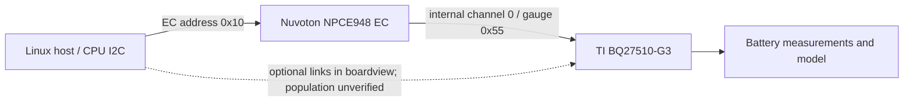

# Dell Venue 5055 battery research

**An auditable case study of ACPI battery misreporting, an EC-mediated BQ27510-G3 interface, and a bounded Qmax experiment.**

Repository: **[https://github.com/kjakobczyk/venue5055-battery-research](https://github.com/kjakobczyk/venue5055-battery-research)**

Author: **Krzysztof Jakóbczyk**. Study date: **31 October 2026**. One device: Dell Venue 10 Pro 5055, board `084N67`, BIOS A04, Ubuntu 26.10, kernel `7.3.0-9-generic`.

This project documents how battery telemetry was traced from Linux ACPI through a Nuvoton EC to a Texas Instruments fuel gauge. It includes the research paper, measured evidence, checksums, analysis tools, and historical hardware scripts. It is a research artifact, not a generic battery-rejuvenation utility.

**The completed experiment changed a model parameter and then reset the gauge. It did not demonstrate recovery of physical cell capacity.** There was no reset-only control, independent discharge-capacity measurement, or cycle-count reset.

## Results at a glance

| Finding | Evidence-backed result |
|---|---|
| ACPI defect | `BAT0._BST` used remaining charge (`RECA`) for the voltage slot instead of voltage (`PRVO`). |
| Minimal correction | Six AML bytes changed, including OEM revision and checksum; patched table verified after reboot. |
| Initial OS inconsistency | sysfs reported 173% charge and 5.973 V while the EC reported 4.261 V. |
| Direct access attempt | Five targeted `0x55` voltage reads failed with errno 121; no address scan. |
| Firmware | Official Dell A04 and A07 packages contain byte-identical 131,072-byte EC components. |
| Host interface | EC block `0x65` writes a logical register; `0xF1` reads logical registers `0x10–0x1F`. |
| Live gauge identity | DeviceType `0x0510`, FW `0x0400`, ChemID `0x3353`, DFVersion `0x2202`. |
| Configuration acquisition | 25 checksum-verified DataFlash blocks, totaling 800 bytes. |
| Persistent experiment | Only Qmax0 bytes at class 82 offsets 2–3 changed; one BQ reset followed. |
| Verification | Cycle count stayed 49; class-91 and class-93 resistance blocks were byte-identical before/after. |

| Immediate model output | Before | After Qmax edit + reset |
|---|---:|---:|
| Qmax0 | 7720 mAh | **8794 mAh** |
| Full-charge capacity (FCC) | 5973 mAh | **6827 mAh** |
| FCC / design capacity | 68.81% | **78.65%** |
| Gauge SOH | 78% | **95%** |
| SOH status | 1 | 1 |
| Cycle count | 49 | **49** |
| SOC | 97% | 92% |
| Voltage | 4213 mV | 4213 mV |
| Active profile | 0 | 0 |

FCC increased by **854 mAh (14.30%) in the reported model output**. SOH is a separate gauge estimate and must not be substituted for FCC/design capacity. A reset can alter volatile model state, so this single sequence does not isolate the effect of Qmax alone. The changed SOC is a recalculation, not a measurement of charge consumed during the experiment.

## Paper and reading order

- [Research paper PDF](paper/main.pdf), [LaTeX source](paper/main.tex), and [bibliography](paper/references.bib).
- [Detailed protocol](docs/PROTOCOL.md): wire format, registers, checksums, byte order, and access classes.
- [Claim-to-evidence map](docs/EVIDENCE.md): what was observed, inferred, corrected, or left unmeasured.
- [Reproduction guide](docs/REPRODUCIBILITY.md): offline checks, firmware extraction, build instructions, and hardware-script limitations.
- [Limitations and next experiments](docs/LIMITATIONS.md).
- [Release preparation](docs/RELEASE.md): source-package contents and intentionally absent publication identifiers.

The manuscript is a draft for author review. No arXiv identifier, DOI, or journal acceptance has been assigned.

## Start here: verify the evidence offline

From the repository root:

```sh
python3 tools/offline/verify_evidence.py
```

This uses only the Python standard library. It opens no device node, changes no system configuration, downloads nothing, and does not import the hardware scripts. It checks:

- release hashes for 63 exported artifacts;
- CRCs for 2376 recorded EC reply frames;
- checksums and source-session correspondence for all 25 DataFlash blocks;
- the exact two-byte State-block difference and the unchanged resistance blocks;
- the three payload/commit writes and single reset in the intervention transcript;
- ACPI patch metadata, initial inconsistency, and boot verification;
- five failed direct-gauge probes and A04/A07 EC-component equality metadata.

These are consistency checks against recorded evidence. They do not independently repeat hardware acquisition or cryptographically attest that a transcript came from a particular device.

To rebuild figures, install the plotting dependency in a local virtual environment:

```sh
python3 -m venv .venv
.venv/bin/pip install 'matplotlib>=3.10.7,<4'
.venv/bin/python tools/offline/make_figures.py
```

To compile the paper with a standard TeX installation:

```sh
make paper
```

To generate local GitHub and arXiv source archives after verification:

```sh
make bundles
```

These targets do not contact GitHub/arXiv or invoke hardware tools.

## What led to the interface

### 1. Validate the ACPI layer first

Known EC battery blocks `0xA2` and `0xA3` provided a useful baseline. Each response comprised a length byte, sixteen payload bytes, and CRC-8. At the first preserved snapshot, the EC reported full capacity 5973 mAh and 4261 mV. Linux simultaneously showed `charge_full=3459000`, `charge_now=5973000`, `voltage_now=5973000`, and `capacity=173`.

The voltage defect was explicit in the DSDT: `_BST` assigned `RECA` to `BSTP[3]`, although `PRVO` was available. A minimal early-boot override changed the source name, OEM revision, and checksum. After reboot, the loaded-table fingerprint matched and voltage agreed exactly at 4256 mV. Full capacity refreshed to 5973 mAh, but the cause of the earlier stale `_BIX` information was not isolated. The voltage edit must not be credited with fixing every cache/refresh issue.

### 2. Treat connectivity as a separate question

A targeted read of gauge voltage at address `0x55` failed on each of the five host adapters. The supplied GenCAD boardview connected the gauge to EC pins B8/C8 and the CPU to a different EC interface at E2/F2. Optional links existed in the design, but their population was not inspected. Pull-up rails differed between the segments in the boardview. No physical bridge was installed.



The dashed edge represents an unverified design option, not a tested path. Negative I2C replies do not prove why a device failed to respond.

### 3. Find the EC image, not just the host updater

Initial WMI/AML and UEFI inspection identified service calls and an EC updater but did not establish a safe gauge tunnel. An early third-party SPI reference was not a local dump and was not treated as authoritative firmware identity.

Official Dell update packages were then extracted offline. Their AMI UAF overlay contained `@EC0` as a compressed component. The A04 and A07 components were identical after decompression. Strings and two embedded 6755-byte programming scripts anchored CR16C analysis. Script pointers included a `+0x20000` address mapping relative to file offsets.

Tracing those callers exposed a shared internal transaction engine. Independently tracing the host register dispatcher reached that same engine. This supplied a concrete hypothesis for software access, which was then validated with fixed voltage and identity reads. The built-in SDI/SIMPLO programming scripts were never replayed.

### 4. Separate readout from persistent changes

The gauge interface uses volatile EC request registers. Request completion returns status `0x80`; voltage-word results reside at EC `0x1C/0x1D`, not at the beginning of `0xF2`. The first decoder made that mistake; both the failed interpretation and corrected raw-frame decoding are preserved.

A later guard incorrectly treated live bits in EC register `0x17` as part of the channel number. It stopped acquisition before the next trigger, restored selectors, and was corrected to separate channel selection from bus state. The interrupted session's three valid blocks and the completed session's twenty-two blocks form the 25-block acquisition.

### 5. Scope the completed intervention precisely

Fresh State, reference-profile, and both profile-0 Ra blocks were saved immediately before the experiment. Qmax0 changed from stored bytes `1e 28` to `22 5a`; all other State bytes were preserved. The payload writes were:

```text
BQ register 0x42 <- 0x22
BQ register 0x43 <- 0x5a
BQ checksum 0x60 <- 0xac
one Control RESET: 0x0041
```

This is an audit of what occurred, not an instruction to replay these bytes on another battery. The checksum depends on the entire current block. A stale checksum or snapshot can overwrite valid learned state. The included intervention source retains a fixed explicit invocation flag and platform/data guards; no build target runs it.

Post-reset readback confirmed the edited State block, unchanged cycle counters, profile 0, and byte-identical Ra/Rax blocks. No rollback was needed; a power-loss recovery path was not tested. The device was left with Qmax0=8794 mAh. Neither the counter-only experiment nor the broader proposed Ra/relearning reset was executed.

## Important measured settings

| Setting | Observed value |
|---|---:|
| Design capacity | 8680 mAh |
| Device-resident default Qmax, both profiles | 8794 mAh |
| Active learned Qmax before the experiment | 7720 mAh |
| Load mode / select | 1 / 1: constant-power model, average power since discharge began |
| Gauge terminate voltage | 3420 mV |
| SystemDown set threshold | 3517 mV |
| Reserve charge / energy | 0 / 0 |
| Charging voltage | 4350 mV |
| Taper current | 421 mA |
| Quit current | 40 mA |
| SOH reference load | -400 mA |

The reference profiles are stored on this particular device. Their values are not proof that the present battery can still deliver that charge. Higher learned resistance can make the gauge predict earlier arrival at its termination voltage under load.

## Layout

```text
paper/                    LaTeX manuscript, bibliography, generated figures/PDF
  figures/                Original plots generated from the recorded evidence
evidence/                 Exported study measurements and provenance
  acpi/                   Initial readings and minimal-patch verification
  topology/               Derived boardview connectivity, not vendor CAD
  firmware/               Package/component hashes and analysis metadata
  transport/              Direct-access failures, bridge replies, corrections
  gauge/                  Gauge identity and standard diagnostic snapshots
  dataflash/              Two session transcripts and 25 measured blocks
  intervention/           Fresh before/after blocks and transaction journal
  manifest.json           Source/release hashes and export transformations
tools/offline/            Device-free verification, extraction, plots, packaging
tools/analysis/           Historical static-analysis script snapshots
tools/hardware/           Historical platform-specific experiment scripts
docs/                     Protocol, evidence map, limitations, release notes
dist/                     Generated source/review archives
work/                     Ignored local vendor inputs and derived work files
```

## Boundaries of the result

This is **one device, one persistent experiment, one gauge reset**. There was no reset-only baseline, repeated-cell study, controlled discharge, or independent measurement of stored energy. The firmware path was reconstructed in relevant slices, not formally verified as a complete program. Full live EC memory, optional-link population, and physical bus waveforms were not acquired. The backup excludes reserved memory and most OCV-table bytes.

The finding does not establish a remote exploit, discovered unseal keys, generic support for other BQ parts, or compatibility with every Dell Venue assembly. Adapter numbering must be checked against the ACPI path. Root privileges and an unsealed gauge were preconditions in this case.

## Sources, attribution, and licenses

Core manufacturer references are the [BQ27510-G3 TRM (SLUUA97)](https://www.ti.com/lit/ug/sluua97/sluua97.pdf), [Impedance Track theory (SLUA450A)](https://www.ti.com/lit/an/slua450/slua450.pdf), and [learning-cycle guidance (SLUA597)](https://e2e.ti.com/cfs-file/__key/communityserver-discussions-components-files/180/1185.slua597.pdf). Exact package identities and download URLs are in `evidence/firmware/`. Tool references and inspected revisions are in [the bibliography](paper/references.bib).

Original code: [MIT](LICENSE-CODE). Manuscript, documentation, original figures, and study data: [CC BY 4.0](LICENSE-DATA). Third-party firmware, source projects, and board designs retain their own rights and are not relicensed by this project. See [third-party notices](THIRD_PARTY_NOTICES.md).

OpenAI Codex assisted exploratory analysis, code generation, and manuscript drafting. The evidence supports the stated verification scope; it does not represent independent human replication. The named author must review the manuscript and release before submission. No AI system is listed as an author.
